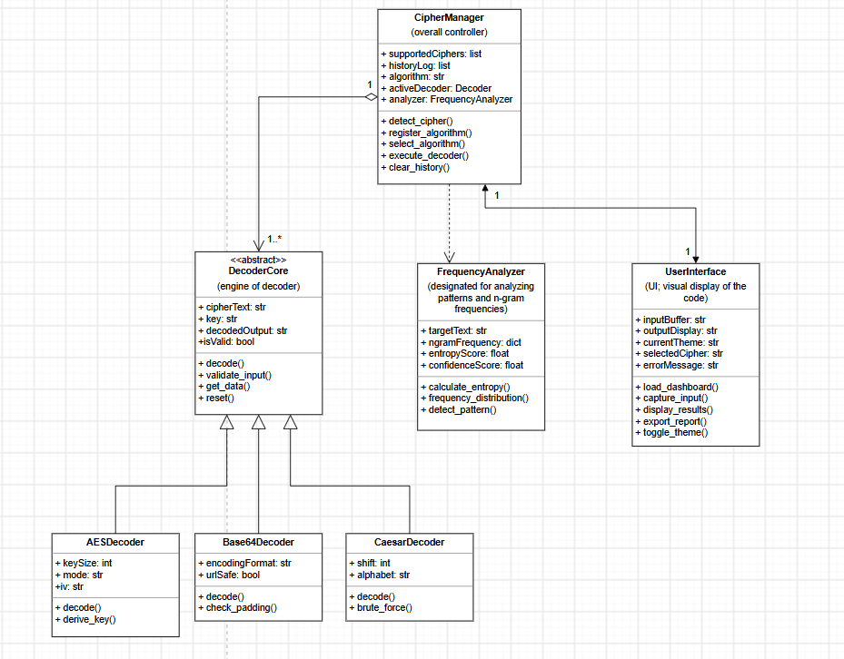

# CS3SY26_ProjectProposal by Aline Teresa Mendoza from CS Unit of PSHS

## Project Proposal Template: 

### Project Title or Name of the Application	: Cryptographic Decoder
### Section			   	      : Sodium
### Group Members			    : SALONGA, Jian Achilles; TANDOG, Johannes Brylle; TICZON, Christopher Manuel
### Date (Proposal Date)  : Nov 20, 2026

### Project Description:

- Our Cryptographic Decoder is a program designed to simplify the process of decryption. In today's world where data privacy is seen everywhere, cybersecurity professionals, cryptanalysts, and hobbyists regularly encounter encrypted texts requiring immediate decoding. Our software allows users to detect the overall cipher type and apply appropriate decoding methods to transform the encrypted data into human-readable messages.

- Describes system components, features, and expected outputs clearly and logically. NOTE: Clearly described the elements(classes), their attributes and methods and how they will interact with each other.

- • Cybersecurity Professionals/Students: People learning, teaching, or using cryptograhy, cryptanalysis, and encoding standards for their requirements.
  
  • Cryptanalysts: Professionals who analyze ciphers, encryption systems, and security implementations to find weaknesses and access encrypted data without knowing the key.
  
  • Hobbysists: Cryptography enthusiasts who need fast and relaible tools to decode cipher/cipher layers during competitions or for games.
  
  • Software Developers: Professionals needing a quick tool to inspect strings for ciphers in their software/programs.

- Class Diagram: 

### Goals:

Describe the long term outcomes of your project followed by a couple of objectives to meet the goals stated in this paragraph

- Objective 1:
- Objective 2:
- Objective n:

[Click here for Rubrics and Sample projects](https://docs.google.com/document/d/1xKd1CqK6DcNWS2_oJPBNtY5n3I3Hqiw8FY3W295Iqfk/edit?usp=sharing)
